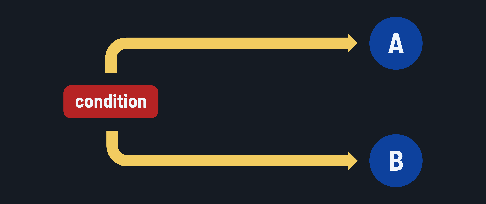

<h1>
  <span class="headline">Intro to Python for Scripting</span>
  <span class="subhead">Branching</span>
</h1>

**Learning objective:** By the end of this lesson, students will be able to apply Python's `if`, `elif`, and `else` statements to implement conditional logic in a script.

## Branching



Branching allows you to make decisions in your code based on certain conditions. In Python, you can use the `if`, `elif` (else if), and `else` statements to create branching logic. Let's see each of these in action.

### `if`

Here's an example of just a conditional `if` statement that prints a message if a person is a minor:

`intro_to_python.py`

```python

age = 18

if age < 18:
    print("You are a minor.")
```

Note the colon `:` at the end of the `if` statement. This indicates that the following indented block of code is part of the `if` statement. The indentation is significant in Python, as it defines the scope of the code block.

If you execute this code, it won't print anything because the condition has not been met. If you change the value of `age` to a number less than 18, it will print `"You are a minor."`.

### `if...else`

You can also use the `else` statement to provide an alternative block of code that will be executed if the condition in the `if` statement is not met. `else` cannot be used without an `if` or `elif` statement immediately before it.

In this example, we will check if a person is a minor. If not, we know that they are an adult:

`intro_to_python.py`

```python
age = 18

if age < 18:
    print("You are a minor.")
else:
    print("You are an adult.")
```

In this code, if the `age` is less than 18, the message `"You are a minor."` is printed. If the condition is not met (if `age` is 18 or greater), the message `"You are an adult."` is printed.

### `if...elif`

You can use the `elif` statement to check for multiple conditions. The `elif` statement allows you to specify additional conditions to check if the previous `if` or `elif` conditions are not met, allowing you to create two or more code paths with specific conditions. You can optionally add a final `else` statement to handle any cases that don't match the provided conditions.

When you have several conditions to check, think of `if...elif` like multiple doors to choose from. Only one door can be entered based on the first condition that is true.

`intro_to_python.py`

```python
age = 18

if age < 18:
    print("You are a minor.")
elif age >= 18 and age < 65:
    print("You are an adult.")
else:
    print("You are a senior.")
```

Remember that the `else` statement is optional. You can have multiple `elif` statements without an `else` statement at the end if you don't need a default case.

In this code, the `if` statement checks if the age is less than 18. If it is, the corresponding block of code is executed, and the message `"You are a minor."` is printed. If the condition is not met, the `elif` statement checks if the age is between 18 and 64 (inclusive). If it is, the message `"You are an adult."` is printed. If none of the previous conditions are met, the `else` block is executed, and the message `"You are a senior."` is printed.

The `if`, `elif`, and `else` statements allow you to create branching paths in your code based on different conditions. You can have multiple `elif` statements to check for various conditions, and the `else` block is executed if none of the conditions are met.

Let's consider an example to solidify our understanding of branching. Imagine you're creating a simple grading system that assigns letter grades based on a student's score. Here's how you could implement it using branching:

``` python
score = 85

if score >= 90:
    grade = "A"
elif score >= 80:
    grade = "B"
elif score >= 70:
    grade = "C"
elif score >= 60:
    grade = "D"
else:
    grade = "F"

print("Your grade is:", grade)
```

In this example, the `if` and `elif` statements check the student's score against different thresholds and assign the corresponding letter grade. The else block is used as a catch-all for scores below 60, assigning the grade "F".

Branching is a fundamental concept in programming that allows you to create dynamic and responsive code. It enables you to make decisions and execute different blocks of code based on specific conditions.

<div class="activity solo-exercise">
  <h2 class="title">Should you go through the traffic signal?</h2>
  <span class="minutes">5 min</span>
</div>

First, create a variable named `color` and give it a value of your choice.

Then, write a branching statement that prints the following based on the value of `color`:

- If the value of `color` is `"green"`, print `"Go"`.
- If the value of `color` is `"yellow"`, print `"Slow"`.
- If the value of `color` is `"red"`, print `"Stop"`.

Manipulate the value of `color` to ensure you're able to print all of the above values.
