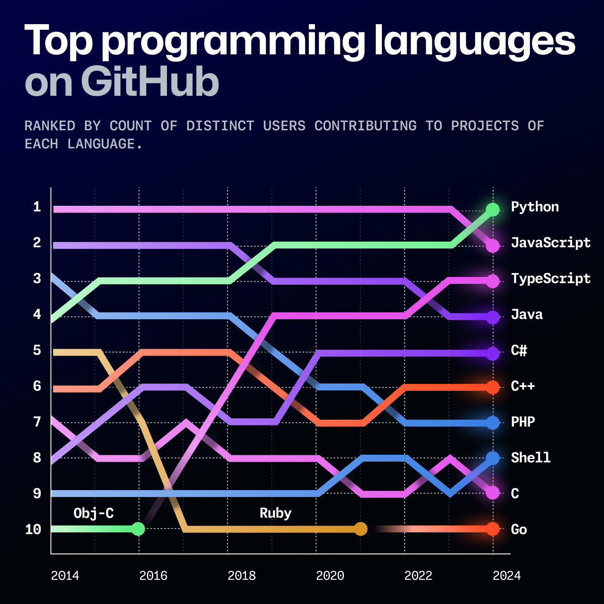

<h1>
  <span class="headline">Intro to Python for Scripting</span>
  <span class="subhead">Concepts</span>
</h1>

**Learning objective:** By the end of this lesson, students will be able to describe what the Python programming language is and why it's such a valuable tool.

## What is Python?

Python is a high-level, general-purpose programming language known for its ease of use and readability. It was first released in 1991 to provide programmers with a way to write clear, logical code for small and large-scale projects.

One of the key strengths of Python is its versatility. Python can be used for a wide range of applications, including web development, scientific computing, data analysis, artificial intelligence, and of course, scripting.

Its high-level nature means that developers can write applications without worrying about low-level details such as memory management, speeding up development.

Python is a dynamic scripting language, which means that code doesn't have to be compiled before it can be executed - it runs within an interpreter that handles the conversion into machine code line-by-line on the fly. This allows for rapid prototyping and testing, making Python an excellent choice for scripting tasks.

Python's simplicity and versatility have contributed to its widespread adoption in various fields, making it one of the most popular programming languages today. The following data from GitHub since 2015 illustrates Python's steadily rising popularity, becoming the most popular programming language on GitHub in 2024.



## Why use Python?

There are many reasons for learning and using Python:

- **Versatility and flexibility**: Python's use cases span different domains, making it a valuable tool for anyone to have in their toolkit.
- **Ease of learning and readability**: Python's syntax is designed to be intuitive, lowering the barrier to entry for beginners. It often uses English keywords, whereas many other languages use punctuation or symbols, making it easier to read and understand.
- **Cross-platform compatibility**: It runs on various systems without significant modifications, facilitating widespread use.
- **Continuous development**: Python is an open-source language with a vibrant community and ecosystem. It receives regular updates and improvements, adding new functionality and keeping it relevant as technology trends evolve.
- **Community**: The Python community is known for its inclusivity, diversity, and supportive nature. Events like PyCon, local Python user groups, and online communities foster a sense of belonging and provide opportunities for networking and knowledge sharing.

  Python's popularity and community support make it an excellent choice for beginners and experienced developers. You'll never feel alone on your Python journey, as there's always someone willing to lend a helping hand.
- **Robust community and libraries**: With an extensive standard library (functionality built into the language) and third-party and third-party modules on the [Python Package Index (PyPI)](https://pypi.org/) for nearly every task imaginable, Python's ecosystem is rich and supportive.

These aspects, coupled with the increasing demand for automation, data analysis, and web development skills, make Python a highly sought-after skill in the job market. The growth of its community and the expansion of its applications continue to open new job opportunities.

## Getting Started with Python

Now that we better understand what Python is and why it's so popular let's dive into the practical aspects of getting started with Python.

### Checking Python Installation

You should already have Python installed on your system - you can check this by running the following command in your terminal:

```bash
python3 --version
```

If Python is installed, you should see the version number displayed. For example:

```bash
Python 3.13.1
```

### Running Python code

Python provides two primary ways to run code: through the interactive shell and executing Python scripts.

1. **Interactive shell**

   The Python interactive shell is a great way to experiment with Python code and get immediate feedback. To start the interactive shell, open a terminal and type `python3`. You'll see the Python prompt (`>>>`), indicating that you can start entering Python code.

   In the interactive shell, you can type Python statements and expressions, and the interpreter will execute them immediately. This is useful for testing small code snippets, exploring Python features, and quickly prototyping ideas.

   Type `quit()` or press <kbd>Ctrl</kbd> + <kbd>D</kbd> to exit the interactive shell.

2. **Python scripts**

   For more complex projects and automation tasks, you'll typically write Python code in a file with a `.py` extension like we've already created. These files are known as Python scripts.

   To run a Python script, open a terminal, navigate to the directory where the script is located, and run the command `python3 script.py`, replacing `script.py` with the actual name of your script file. For example, to run the `intro_to_python.py` script we created earlier, you would use the following command:

   ```bash
   python3 intro_to_python.py
   ```

   Python will execute the code in the script from top to bottom, and any output or results will be displayed in the terminal. This script is empty now, so you won't see any output, but we'll resolve that soon enough!
