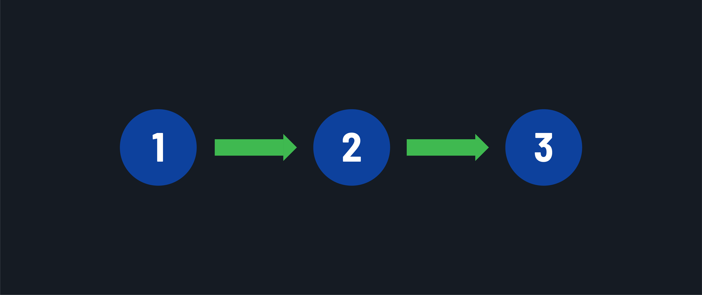
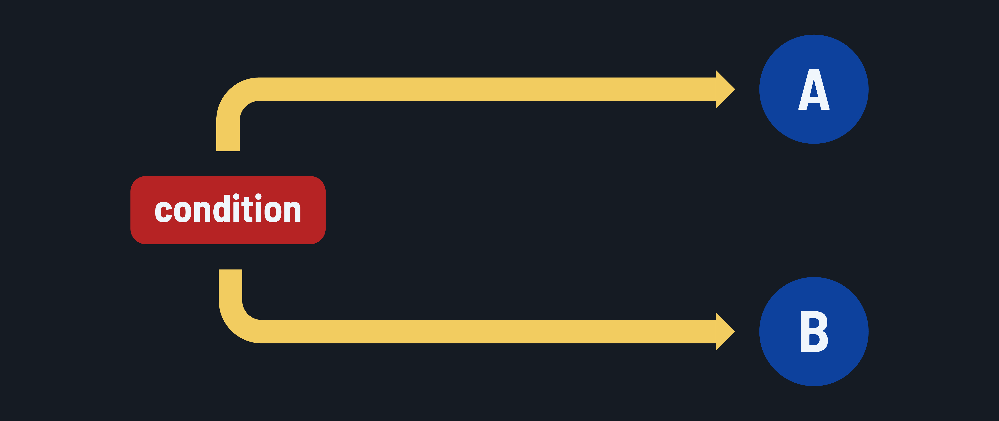
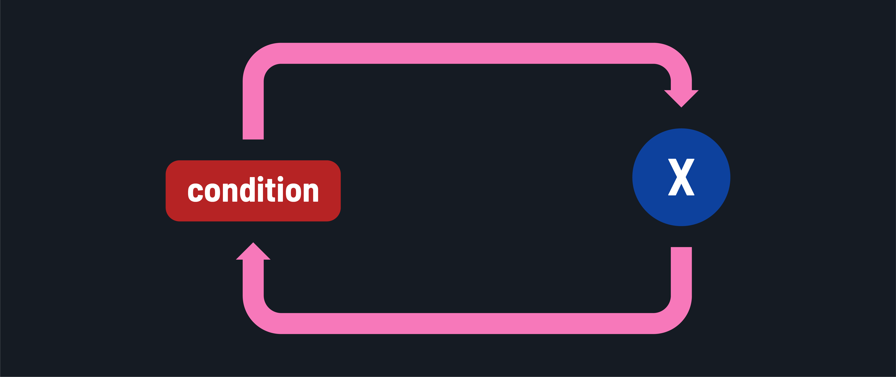

<h1>
  Intro to Python for Scripting
  Control Flow Concepts
</h1>

**Learning objective:** By the end of this lesson, students will be able to describe the three types of control flow and their importance in programming.

## What is control flow?

Control flow in programming refers to the way we manage the order in which code is executed within a program. It's like having a set of instructions and deciding when and how to follow them. Control flow becomes crucial when we want our program to behave differently based on certain conditions or user input. So what methods do we have available to us to make those decisions in our code?

### Types of control flow

There are three main types of control flow in programming:

1. **Sequence**: Statements are executed one at a time in succession. This is the most basic and default form of control flow.

   

2. **Branching**: Think of this as a fork in the road. Depending on a condition, the program can take one path or another.

    

3. **Looping**: The code inside the loop will execute repeatedly while a condition is true. This means that a block of code will run multiple times.

   

## Why is control flow important?

By default, when you run a program, it starts executing from the top line of code and continues sequentially until it reaches the last line. This linear execution doesn't align with the needs of most applications. In reality, we often need to change or manipulate the order of execution to achieve specific goals, such as:

- **Decision-making**: Sometimes, we need the program to make choices and execute different code paths based on conditions. For example, showing different messages to users based on their input.
- **Repetition**: Many tasks involve performing the same actions multiple times. Control flow allows us to create loops to repeat a set of instructions until a certain condition is met.
- **User interaction**: Applications often respond to user actions. Control flow lets us manage these interactions, triggering specific actions when users click buttons, enter data, or perform other actions.
- **Error handling**: Handling errors gracefully is essential. Control flow helps us navigate errors by directing the program to take specific actions when something goes wrong.

In essence, we don't always want our code to run straight from top to bottom. Control flow is the fundamental mechanism that enables us to shape the behavior of our programs, making them smart and adaptable to various scenarios.
