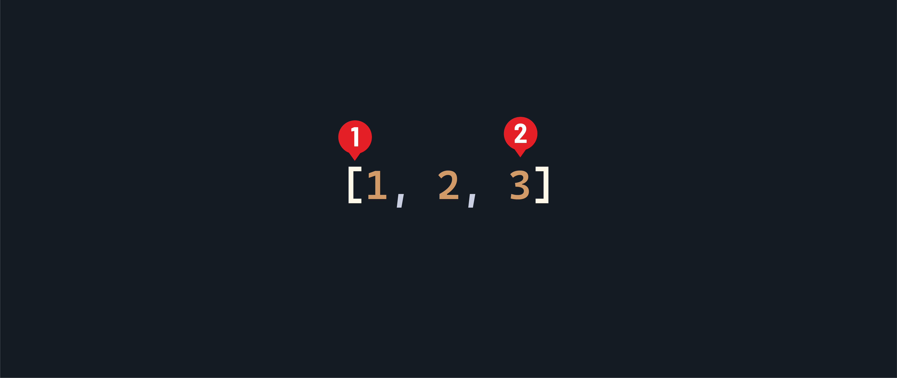
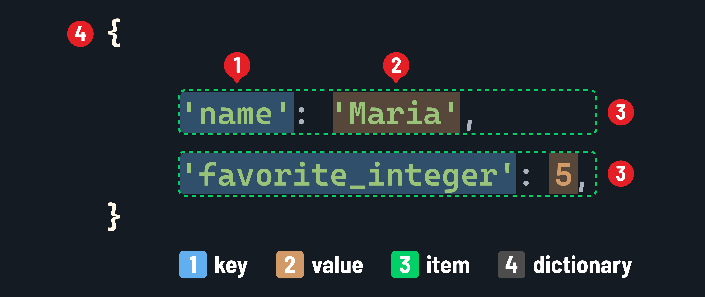

<h1>
  <span class="headline">Intro to Python for Scripting</span>
  <span class="subhead">Data Types and Variables</span>
</h1>

**Learning objective:** By the end of this lesson, students will be able to utilize Python data types and variables.

## Data types

Everything in Python has a data type, which defines the value it represents and the things you can do with it (called *operations*). Data types are essential in Python because they determine the program stores, manipulates, and reads data.

Python has several built-in data types that you can use to represent different kinds of values. Let's take a closer look at some commonly used data types.

### Numbers

A number is a basic data type that represents a numeric value. Python supports two main types of numbers:

- Integer(`int`): Represents whole numbers, such as `-5`, `0`, and `42`.
- Float (`float`): Represents decimal numbers, such as `3.14`, `-2.5`, and `1.0`.

We can confirm the type of any data in Python using the `type()` function:

`intro_to_python.py`

```python
print(type(42))
# Prints: <class 'int'>
print(type(3.14))
# Prints: <class 'float'>
```

### Strings

A string (`str`) represents a sequence of zero or more characters enclosed in single quotes (`'...'`) or double quotes (`"..."`). Strings can contain letters, numbers, symbols, and whitespace characters.

`intro_to_python.py`

```python
print(type("Hello, World!"))
# Prints: <class 'str'>
print(type('Python is awesome'))
# Prints: <class 'str'>
print(type(""))
# Prints: <class 'str'>
print(type('42'))
# Prints: <class 'str'>
```

### Booleans

Strings and numbers can have a virtually unlimited number of values, but the boolean (`bool`) data type can only have two possible values: `True` or `False`.

Booleans are useful for their simplicity and are often used to make decisions in programming.

`intro_to_python.py`

```python
print(type(True))
# Prints: <class 'bool'>
```

### Sequences

A list (of type `list`) is a collection of zero or more items (called *elements*) that are typically the same data type. Lists are ordered, mutable (changeable), and can contain duplicate elements. Lists can contain any data type.

A list is created by enclosing the elements in square brackets (`[...]`), separated by commas. The basic syntax looks like this:



1. The square brackets (`[...]`) indicate that this is a list.
2. The list's elements are placed inside the square brackets, separated by commas. When initializing a list, you don't have to include elements; use empty square brackets (`[]`) to create an empty list.

`intro_to_python.py`

```python
print(type([1, 2, 3]))
# Prints: <class 'list'>
print(type(["apple", "banana"]))
# Prints: <class 'list'>
```

Python also has a special type of list called a tuple (with the type `tuple`), which is similar to a list but is immutable (unchangeable). Tuples are created by enclosing the elements in parentheses (`(...)`).

`intro_to_python.py`

```python
print(type((1, 2, 3)))
# Prints: <class 'tuple'>
print(type(("apple", "banana")))
# Prints: <class 'tuple'>
```

### Dictionaries

A dictionary (`dict`) is used to store related data. For example, if we want to store information about a car, we can use a dictionary to store its make, model, and color. Each piece of information is stored as a *key-value pair* called an *item*.

Dictionaries are unordered, mutable, and can contain any data type.

To create a dictionary, use curly brackets (`{...}`) and separate the key-value pairs with commas. Each key is followed by a colon (`:`) and its corresponding value. The basic syntax looks like this:



1. A key
2. A value
3. An item - or a `key: value` pair
4. The curly brackets (`{...}`) indicate that this is a dictionary.

`intro_to_python.py`

```python
print(type({"make": "Toyota"}))
# Prints: <class 'dict'>
```

When a dictionary has multiple key-value pairs, it is common to put each key-value pair on a separate line for readability:

`intro_to_python.py`

```python
print(type({
    "make": "Toyota",
    "model": "Camry",
    "color": "blue"
}))
# Prints: <class 'dict'>
```

## Variables

Variables are used to store and manipulate data in Python. They act as containers that hold values of different types, such as numbers, strings, or more complex objects.

Python is a dynamically typed language, meaning you don't need to explicitly specify the data type of a variable. Python infers the data type based on the value assigned to the variable.

### Creating variables

To create a variable in Python, choose a name for the variable and use the assignment operator (`=`) to assign a value to it. For example:

`intro_to_python.py`

```python
name = "Alice"
age = 25
height_in_meters = 1.75
```

In the above code, we create three variables: `name` (a string), `age` (an integer), and `height` (a floating-point number).

Python has some rules and conventions for variable names:

- Variable names can contain letters (a-z, A-Z), digits (0-9), and underscores (_).

- Variable names cannot start with a digit.

- Variable names are case-sensitive (`num` and `Num` are different variables).

- Variable names cannot be identical to any of Python's [reserved keywords](https://docs.python.org/3/reference/lexical_analysis.html#keywords).

- Choose descriptive and meaningful names that reflect the purpose of the variable.

- When a variable name consists of multiple words, it is a convention (but not a requirement) to use underscores to separate them (for example, `height_in_meters`, as we used above).

### Accessing variables

Use the name of a variable to access its value. Variables can be used anywhere you can use data. For example:

`intro_to_python.py`

```python
print(name)
# Prints: Alice
print(age)
# Prints: 25
print(height_in_meters)
# Prints: 1.75
```

<div class="activity solo-exercise">
  <h2 class="title">Data types and variables practice</h2>
  <span class="minutes">10 min</span>
</div>

Let's reinforce our understanding of variables and data types with a few practice exercises. Try solving these exercises independently and then we'll review the answers.

1. Create a variable called `favorite_color` and assign it a string value representing your favorite color. Print the value of `favorite_color`.

2. Create two variables, `num_a`, and `num_b`, and assign them numeric values. Calculate their sum and store the result in a new variable called `sum`. Print the value of `sum`.

3. Create a variable called `is_raining` and assign it a boolean value representing whether it is currently raining. Print the value of `is_raining`.

4. Create a list called `fruits`, and add three of your favorite fruits as strings to the list. Print the contents of the `fruits` list.

5. Create a dictionary called `person` with keys `"name"`, `"age"`, and `"city"`, and assign appropriate values to each key. Print the value of the `"name"` key.

Practice is key to becoming comfortable with variables and data types in Python. Don't hesitate to experiment and try different variations of these exercises to deepen your understanding.
